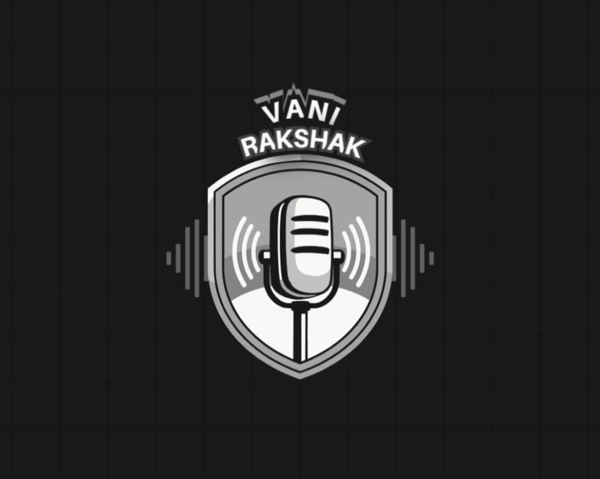
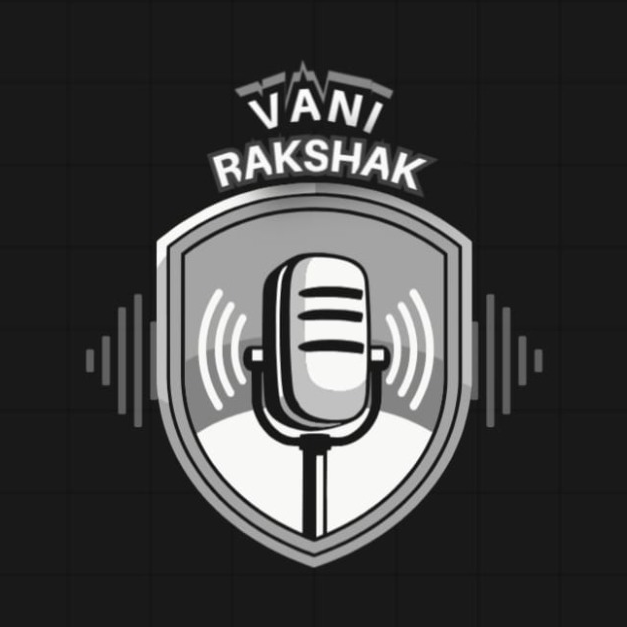

<div align="center">

  

  <br/><br/>

  <h1>VaniRakshak Kavach (वाणी रक्षक कवच)</h1>
  <p><strong>Next-Gen Real-Time Voice Scam Shield &amp; Live Evidence Grounding System</strong></p>

  <p><em>"Vani" = Voice/Speech | "Rakshak" = Guardian/Protector | "Kavach" = Shield/Armor &bull; Autonomous real-time defense against digital arrest coercion, financial KYC extortion, and synthetic voice fraud.</em></p>

  <p>
    <a href="#-quickstart"></a>
    <a href="https://python.org"></a>
    <a href="https://fastapi.tiangolo.com"></a>
    <a href="https://github.com/BeastAyyG/VaniRakshak/tree/ayush"></a>
    <a href="LIVE_STREAM_INTEGRATION_GUIDE.md"></a>
    <a href="LICENSE"></a>
  </p>

</div>

---

## 👨‍💻 Creator & Maintainer

| | |
|---|---|
| **Architect & Creator** | **Ayush Agnihotri** |
| **GitHub** | [@ayushagnihotrii](https://github.com/ayushagnihotrii) / [@BeastAyyG](https://github.com/BeastAyyG) |
| **Repository** | [BeastAyyG/VaniRakshak](https://github.com/BeastAyyG/VaniRakshak) |
| **Project Focus** | Real-Time Voice Threat Intelligence, Scam Heuristics & Ground-Truth Verification |

> **VaniRakshak Kavach** is conceptualized, engineered, and designed by **Ayush Agnihotri** to provide citizens and enterprises with real-time immunity against escalating voice fraud, digital arrest intimidation, and financial extortion.

---

## 📖 Executive Summary

**VaniRakshak Kavach** is an AI-powered speech intelligence and threat defense system. It intercepts, transcribes, and forensically audits live phone calls and voice recordings in real time.

Operating across **Hindi, Hinglish, and English**, VaniRakshak Kavach evaluates multi-dialect conversational acoustics against an extensive threat matrix, detects coercion markers, and autonomously cross-references claims against live authoritative web evidence in sub-seconds.

```
       Incoming Phone Call / Intercepted Audio Stream
                            │
                            ▼
┌────────────────────────────────────────────────────────────────────────┐
│                VaniRakshak Kavach Speech & Scam Pipeline                │
│                                                                        │
│  1. 🎙️ Stream Ingestion   — Real-time WebSocket or 1-minute audio chunk │
│  2. ⚡ Acoustic ASR Engine — IndicConformer / Groq Whisper LPU (<1.1s) │
│  3. 🔤 Dialect Extraction — Preserves OTP, KYC, CBI, Police, Bank tags │
│  4. 🚨 Threat Matrix     — Real-time risk scoring (0-100) & Coercion   │
│  5. 🌐 Web Grounding     — Crawl4AI autonomous evidence verification   │
│  6. 🛡️ Defense Directive — Instant actionable alert & forensic dossier │
└────────────────────────────────────────────────────────────────────────┘
                            │
                            ▼
     NORMAL CONVERSATION 🛡️ | SUSPICIOUS ⚠️ | CRITICAL SCAM ALERT 🚨
```

---

## ✨ Key Platform Capabilities

### 1. 🛡️ Scam & Digital Arrest Defense Engine
- **Digital Arrest Coercion Detection**: Detects fake police/CBI intimidation, fabricated narcotics parcel allegations, and video-call detention threats.
- **Financial KYC Phishing**: Identifies urgent account suspension warnings, fake bank manager calls, and unverified APK/OTP requests.
- **Utility Disconnection Extortion**: Identifies fake electricity, gas, and telecom disconnection threats demanding immediate mobile contact.
- **Emergency Action Directives**: Delivers unequivocal guidance (e.g., *"Hang up immediately — Report to National Cyber Crime Helpline 1930"*).

### 2. ⚡ Live Voice Call Streaming (Mobile Main App Integration)
- **Bidirectional WebSocket Gateway (`/ws/live-call-stream`)**: Streams raw audio frames (PCM 16kHz Mono / WebM / Opus) from mobile background services with **<300ms** response latency.
- **Rolling Threat Scoring**: Live speech transcripts and risk meters update dynamically as words are spoken.
- **REST Chunked Fallback (`POST /api/stream/call-chunk`)**: Supports intermittent or battery-restricted mobile operating system environments.
- **Complete Developer Reference**: See **[LIVE_STREAM_INTEGRATION_GUIDE.md](LIVE_STREAM_INTEGRATION_GUIDE.md)** for production-ready Kotlin (Android AudioRecord) and Swift (iOS AVAudioEngine) sample code.

### 3. 🌐 Ground-Truth Evidence Verification (Crawl4AI)
- **Autonomous Source Discovery**: Deep-crawls authoritative government portals, regulatory gazettes, and official advisories.
- **Explainable Reasoning**: Every verdict is backed by extract snippets, source URLs, and confidence percentages.

### 4. 🎨 Modern Editorial Studio UI (ElevenLabs / Linear Style)
- **Zero-API Policy**: Stripped of internal engine terminology for a polished, consumer-ready interface.
- **Tactile Voice Studio**: High-contrast circular mic recorder with smooth pulse animations and live canvas waveform visualizer.
- **Drag-and-Drop Audio Dropzone**: Instant support for `WAV`, `MP3`, `WEBM`, `M4A`, and `OGG` files.
- **Direct Text Fact-Checker**: Quick-test prompts for instant claim verification.

---

## 🗂️ Repository Architecture

```
VaniRakshak Kavach/
├── assets/                                     # Official Branding Suite
│   ├── logo.png                                # High-res official emblem logo
│   ├── logo_transparent.png                    # Transparent background emblem
│   ├── logo_icon.png                           # Focused square app icon
│   └── logo_icon_transparent.png               # Transparent icon format
│
├── vanirakshak_indic_conformer/                # Primary Production Edition (Port 8084)
│   ├── run_indic_server.py                     # Entry point server script
│   ├── server.py                               # FastAPI backend + WebSocket streaming
│   ├── indic_conformer_engine.py               # AI4Bharat & Whisper speech recognition
│   └── fact_app/
│       └── static/                             # Web Frontend Assets
│           ├── index.html                      # Modern Editorial Single-Page Application
│           ├── styles.css                      # Unified design tokens & responsive CSS
│           ├── app.js                          # Client synchronization & WebSocket HUD
│           ├── logo.png                        # Web navbar & favicon emblem
│           └── samples/                        # Audited threat audio samples
│
├── vanirakshak_sotto/                          # Sotto OpenVINO Edition (Port 8082)
│   ├── run_sotto_server.py                     # Sotto launcher
│   ├── server.py                               # FastAPI backend (OpenVINO)
│   └── sotto_engine.py                         # OpenVINO Whisper engine
│
├── backend/                                    # Shared ASR Service Layer
│   └── services/
│       └── asr/                                # Speech-to-text subsystem
│           ├── service.py                      # Unified ASR orchestrator
│           ├── provider.py                     # ASR provider base class & factory
│           ├── groq_provider.py                # Groq Cloud Whisper provider
│           ├── indicconformer.py               # AI4Bharat IndicConformer provider
│           ├── preprocessing.py                # Audio normalization pipeline
│           ├── transliteration.py              # Hindi ↔ Hinglish romanization
│           ├── buffer.py                       # Transcript chunk buffer
│           └── types.py                        # Data models & config types
│
├── crawl4ai/                                   # Web Evidence Grounding Engine
├── tests/                                      # Automated test suite
├── scripts/                                    # Benchmark & verification scripts
├── LIVE_STREAM_INTEGRATION_GUIDE.md            # Mobile Call Stream Integration Guide
├── DESIGN.md                                   # UI/UX Design System Reference
├── package.json                                # Node dev scripts & server runner
├── requirements.txt                            # Core Python dependencies
└── README.md                                   # Platform documentation
```

---

## 🚀 Quickstart & Installation

### 1. Prerequisites
- **Python 3.11+** installed.
- **Node.js** (optional, for npm convenience scripts).

### 2. Clone & Setup Virtual Environment
```bash
# Clone the repository (ayush branch)
git clone -b ayush https://github.com/BeastAyyG/VaniRakshak.git
cd VaniRakshak

# Create and activate Python virtual environment
python -m venv .venv
# On Windows:
.venv\Scripts\activate
# On Linux / macOS:
source .venv/bin/activate

# Install dependencies
pip install -r requirements.txt
```

### 3. Environment Variables
Create a `.env` file in the root directory:
```env
# Gemini Intelligence Engine
GEMINI_API_KEY=your_gemini_api_key_here

# Groq Cloud Whisper / Indic Acceleration (Optional)
GROQ_API_KEY=your_groq_api_key_here
```

### 4. Launch the Server
You can start the server using npm or python directly:

```bash
# Option A: Using npm script
npm run dev

# Option B: Direct Python launcher (Port 8084)
python vanirakshak_indic_conformer/run_indic_server.py
```

Open your browser to:  
👉 **`http://localhost:8084`**

---

## 🔌 API & WebSocket Reference

### 1. Real-Time WebSocket Call Stream
```http
ws://localhost:8084/ws/live-call-stream?call_id={CALL_UUID}&caller={PHONE}
```
* **Payload**: Continuous binary audio frames (16kHz, 16-bit Mono Linear PCM or WebM/Opus).
* **Server Broadcasts**: Real-time JSON events containing incremental transcripts, threat scores (0–100), and immediate emergency directives.

### 2. Audio Chunk Analysis (REST)
```http
POST /api/audio/verify-chunk
Content-Type: multipart/form-data

file: [Audio File Binary (WAV/MP3/WEBM)]
verify_fact: true
```

### 3. Mobile Chunk Ingestion (Fallback)
```http
POST /api/stream/call-chunk
Content-Type: multipart/form-data

call_id: "call_982348"
chunk_index: 0
is_final: false
file: [Audio File Binary]
```

### 4. Direct Text Claim Fact-Check
```http
POST /api/verify
Content-Type: application/json

{
  "claim": "Electricity bill unpaid message asking to call mobile number is a scam.",
  "urls": null
}
```

### 5. Health & Diagnostic Check
```http
GET /api/health
```

---

## 📱 Mobile App Ingestion Architecture

VaniRakshak Kavach is designed to pair directly with an active call recording service on Android or iOS.

```kotlin
// Android AudioRecord WebSocket Streamer snippet (Kotlin)
val request = Request.Builder().url("ws://<host>:8084/ws/live-call-stream?call_id=$callId").build()
webSocket = client.newWebSocket(request, object : WebSocketListener() {
    override fun onMessage(ws: WebSocket, text: String) {
        val alert = JSONObject(text)
        if (alert.optInt("threat_score") >= 75) {
            triggerHeadsUpAlert(alert.getString("action_advice"))
        }
    }
})
```

For complete implementation instructions, code samples, and packet schemas, read **[LIVE_STREAM_INTEGRATION_GUIDE.md](LIVE_STREAM_INTEGRATION_GUIDE.md)**.

---

## 🧪 Verification & Testing

Run the automated endpoint and streaming verification suite:
```bash
# Test WebSocket streaming ingestion & threat matrix response
python -c "
import urllib.request
req = urllib.request.Request('http://127.0.0.1:8084/api/health')
print('Server Health:', urllib.request.urlopen(req).status)
"
```

---

## 📄 License

Distributed under the **MIT License**. Copyright &copy; 2024–2026 **Ayush Agnihotri**.

---

<div align="center">
  
  <br/><br/>
  <strong>Built with pride by <a href="https://github.com/ayushagnihotrii">Ayush Agnihotri</a></strong><br/>
  <em>VaniRakshak Kavach (कवच) — Defending speech integrity and safeguarding lives.</em>
</div>
