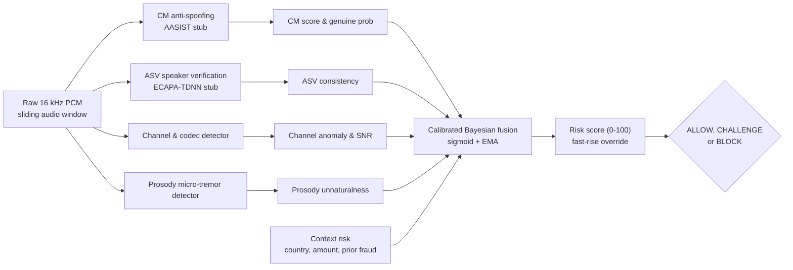

# VaniRakshak

**Target-Conditioned Recorded-Audio Forensic System** — real-time detection of voice-cloning and deepfake-audio fraud on live calls, with an autonomous transaction interlock.

VaniRakshak listens to a live audio stream, scores it for synthetic/manipulated speech, and drives a risk decision (`ALLOW` → `CHALLENGE` → `BLOCK`) that can lock a transaction mid-call and fire alerts.

> **Read this before quoting any number.** The trained checkpoint in `ml/checkpoints/` (`best_model.pt`) is
> fine-tuned for **one enrolled identity only — Narendra Modi** (`data/anchor_speaker_std/`,
> `user_id: narendra_modi`), represented by 8 recordings. It answers "is this that one person?",
> **not** "is this audio synthetic?". It was trained against a single non-target speaker
> (45 clips cut from one recording) and its training set contains **zero** cloned or synthetic
> voices, so it has never seen the thing it is marketed as detecting. It is not a general
> voice-clone detector and its headline `100%` accuracy says nothing about other speakers.
> **A file that used to sit next to it, `countermeasure_cm.pt`, was byte-identical to this one —
> there was never a trained countermeasure, only this identity model under a second name.** It
> has been deleted; a real countermeasure-training path now exists
> (`ml/dataset.py::ASVspoofDataset`, needs a real ASVspoof corpus, not yet trained).
> See [`ml/README.md`](ml/README.md) and [`docs/archive/AUDIT_REPORT.md`](docs/archive/AUDIT_REPORT.md) §12.1 for the
> measured figures and why they do not generalise.
>
> **Separately, real speaker verification now exists as an opt-in backend**: `VR_ASV_BACKEND=ecapa`
> swaps the stub ASV for real speechbrain ECAPA-TDNN embeddings, with measured
> anchor-vs-impostor separation of 0.845 vs 0.199 (zero overlap) — see `docs/archive/AUDIT_REPORT.md` §12.
> This is a different, more general mechanism than the `ml/` checkpoint above and is what makes
> enrolling more than one family member (`POST/GET /v1/enroll`) a real biometric claim.

## Purpose & Vision

VaniRakshak is, at its core, a **voice-authenticity system**: it decides whether the voice
on a call is the *enrolled, real person* it claims to be, or someone (or something) else.
Everything below — the streaming pipeline, the risk tiers, the transaction interlock — exists
to answer that one question reliably and fast.

### Where it started

The system was first built for a single, high-stakes purpose: **guarantee that a call from
Narendra Modi (Modi ji) cannot be faked or impersonated.** One enrolled voice profile — eight
real recordings of Modi ji as captured in `data/anchor_speaker_profile.json`
(`user_id: narendra_modi`) — becomes the anchor. Any inbound or live call claiming to be him is
checked against that anchor. If the voice does not match, it is flagged as *not* the enrolled
Modi voice. The value proposition is deliberately simple and strong: **no one can stand up a
cloned or impersonated "Modi ji" call and have it pass.**

### How it scales: a telecom family-voice safety feature

The same mechanism generalises far beyond one public figure. Carriers already experiment with
scam-detecting calls (for example Airtel's fraud-warning prompts on suspected spam). VaniRakshak
turns that idea inside-out into a **family safety feature sold on a family SIM plan**:

1. **Enroll the family.** When a household takes a family SIM plan, each member records a few
   real voice samples into the carrier's secure enrollment store. These are genuine,
   consenting, in-the-clear recordings — the *ground truth* for that person.
2. **Verify every inbound call.** When a call arrives claiming to be "Dad" or "Mom," the system
   scores the caller's voice against the enrolled sample for that family member.
3. **Real family member, or deepfake?** A strong match ⇒ the caller is the real enrolled family
   member. A weak match ⇒ either a different person *or* a synthetic clone pretending to be them.
   The carrier surfaces a calm verdict ("VERIFIED: this is really Dad" / "COULD NOT VERIFY:
   possible impersonation") and, where configured, steps up to a challenge or blocks the
   transaction.

This is the product carriers can ship: **"know for sure the voice on the line is your real
family member, not a deepfake."** It directly targets the fastest-growing phone-fraud vector —
AI voice cloning used to scam relatives — and gives the carrier a differentiated family-safety
upsell.

> **Honesty note — current model vs. the vision.** The shipped checkpoint proves the
> *mechanism*, not the full claim. It is a one-identity verifier (Modi ji) trained on **zero**
> cloned or synthetic audio, so:
> - It correctly answers *"is this the enrolled voice?"* for the enrolled identity.
> - It has **not** been validated to distinguish a *real non-enrolled human* from a
>   *high-quality deepfake* of that same person, because no synthetic audio was in training.
>   A "not verified" verdict today means "this is not the enrolled voice" — which could be a
>   stranger, a family member not yet enrolled, *or* a clone.
> - Generalising to the family-SIM scenario requires **enrolling each family member on real
>   samples** and **adding cloned/synthetic data to training + evaluation** so the model is
>   actually tested against the thing it must catch.
>
> Treat the family-safety framing as the *design target and deployment model*, validated
> end-to-end only for the single enrolled identity so far. See
> [`ml/README.md`](ml/README.md) for the measured figures.

## How it works

The dashboard streams microphone audio to a forensic backend over WebSocket and renders the verdict in real time.

```
Microphone  →  16-bit PCM @ 16 kHz  →  WebSocket /ws/stream  →  Forensic backend
                                                                      │
                                                                      ▼
                                                     risk_score, spoof_score,
                                                     speaker_similarity, snr_db
                                                                      │
                                                                      ▼
                                                    ALLOW / CHALLENGE / BLOCK
```



> **Architecture Diagrams:** Detailed interactive flowcharts are available in [docs/FLOWCHARTS_CORRECTED.md](docs/FLOWCHARTS_CORRECTED.md) and viewable in your browser at [docs/flowcharts.html](docs/flowcharts.html). The diagram above and that doc both show the **default** stub CM/ASV; `VR_CM_BACKEND=wavlm` / `VR_ASV_BACKEND=ecapa` swap in real pretrained models — see the "Notes" section below and `docs/02-technical-strategy-and-architecture.md`'s Production Upgrade Path table. Not shown above: a parallel, advisory ASR/keyword/claim-verification layer (`vanirakshak/semantic/`) that contributes one small term to the fusion — see `docs/PROTOCOL.md` §3.1.

| Risk score | Label | Action |
|---|---|---|
| `< 35` | LOW RISK | `ALLOW` — transaction proceeds |
| `35 – 69` | SUSPICIOUS | `CHALLENGE` — caller must repeat a dynamic phrase |
| `>= 70` | CRITICAL | `BLOCK` — transaction interlock engages, alerts fire |

`BLOCK` or `risk >= 70` hard-locks the transaction control (`transactionLocked`), disabling the proceed button until the stream clears.

### The four detection stages

The landing experience is a scroll-driven canvas animation (220 pre-rendered frames) walking through the pipeline:

1. **Ingestion** — edge-first capture, 16-bit PCM, sub-12 ms latency
2. **Multi-tier analysis** — STFT and bi-spectral inspection for vocoder phase discontinuities and neural speech footprints (AASIST / LFCC)
3. **Biometric defense** — acoustic spoof detection and speaker-verification similarity scoring
4. **Autonomous action** — real-time interlock and quarantine of the transaction

## Project structure

```
.
├── package.json          # workspace wrapper — delegates to frontend/
├── docs/PROTOCOL.md      # frontend <-> backend WebSocket contract (read this first)
├── docs/API_SPEC.md      # full REST + WS reference
├── docs/INTEGRATION_GUIDE.md  # for third-party (mobile/PBX) integrators, not the bundled dashboard
├── frontend/             # Next.js 16 (App Router) dashboard
│   ├── public/worklets/pcm-capture.js   # AudioWorklet PCM capture
│   └── app/
│       ├── page.tsx                     # console: live stream, risk meter, event log
│       ├── layout.tsx
│       ├── globals.css
│       └── components/
│           ├── ScrollyVideoCanvas.tsx       # scroll-driven animated pipeline explainer
│           ├── ForensicVerdictCard.tsx      # threat verdict card & DPDP audit certificate
│           ├── WaveformEvidenceTimeline.tsx # sliding-window waveform & boundary inspector
│           ├── DemoQuickSelector.tsx        # standardized forensic benchmark selector
│           └── AudioUploadZone.tsx          # custom audio drag-and-drop ingestion
├── ml/                   # 40-dim MFCC identity model (Modi-only) + real ASVspoof CM training path
├── benchmarks/
├── data/
├── backend/              # RETIRED standalone server; keeps only shared model-loading
│                         # modules (real ECAPA/WavLM) + the ASR stack, both imported by
│                         # vanirakshak-backend — see backend/README.md
├── vanirakshak-android/  # native call-guard client (real APK) — own on-device heuristics,
│                         # dev-only backend link (adb reverse) — see its DESIGN.md
├── vanirakshak_sotto/            # standalone fact-check prototype (Groq + Gemini + Crawl4AI
├── vanirakshak_indic_conformer/  # live web verification) — real code, NOT currently runnable
│                                 # (missing deps, no API key, unwired) — see docs/archive/AUDIT_REPORT.md §12
└── vanirakshak-backend/  # Python FastAPI forensic service
    ├── tests/
    │   └── test_stream_e2e.py  # protocol conformance test
    └── vanirakshak/
        ├── server/app.py       # REST + WebSocket endpoints
        ├── session.py          # per-call state, interlock, challenges
        ├── risk/fusion.py      # calibrated Bayesian risk fusion
        ├── detectors/          # asv, channel, cm (spoof), prosody, pipeline
        │                       # (+ asv_ecapa.py / cm_wavlm.py — optional real backends)
        ├── semantic/           # parallel ASR (Groq Whisper) + keyword + claim verification
        ├── challenge/engine.py # dynamic phrase generation + grading
        ├── alerts/             # server-side alert dispatch (webhook)
        └── privacy/            # DPDP-style audit log
```

The wire format between the two halves is documented in **[docs/PROTOCOL.md](docs/PROTOCOL.md)**.

## Getting started

**One command** (boots the venv, backend and dashboard together):

```bash
npm run dev:all     # = node scripts/dev.js
```

Then open **http://localhost:3001**.

Verify the whole vertical slice is wired up:

```bash
python scripts/integration_check.py           # 13 checks, boots the app in-process
python scripts/integration_check.py --live    # or against a running server
```

Full integration status, fixed defects and honest limitations:
[`docs/archive/INTEGRATION_REPORT.md`](docs/archive/INTEGRATION_REPORT.md).

Or run the two halves in separate terminals:

**Backend** (port 8000):

```bash
cd vanirakshak-backend
pip install -r requirements.txt
python run.py
```

**Dashboard** (port 3001):

```bash
npm install --prefix frontend
npm run dev
```

Open **http://localhost:3001** to access the forensic console.

The dashboard provides:
* **Standardized Forensic Benchmark Suite** (`demo_01_genuine.wav` through `demo_04_impostor.wav`) for one-click threat evaluation.
* **Custom Audio Ingestion Zone** for drag-and-drop WAV analysis.
* **Live 16 kHz Microphone Streaming** with real-time risk scoring, vocoder discontinuity detection, and autonomous transaction interlocks.
* **Cryptographic DPDP Act 2023 Audit Certificates** exportable directly from the console.

### Configuration

| Variable | Default | Purpose |
|---|---|---|
| `NEXT_PUBLIC_BACKEND_WS` | `ws://localhost:8000/ws/stream` | Dashboard → backend socket |
| `VR_PORT` | `8000` | Backend port |
| `VR_HOST` | `127.0.0.1` | Backend bind host |
| `VR_CORS_ORIGINS` | `http://localhost:3001,http://127.0.0.1:3001` | Allowed browser origins |

### Other scripts

```bash
npm run build   # production build
npm run start   # serve production build
npm run lint    # eslint
```

## Tech stack

- **Next.js 16.3.4** (App Router) · **React 19.2.8**
- **Tailwind CSS v4**
- **lucide-react** iconography
- **TypeScript 5**
- Web Audio API **AudioWorklet** (`public/worklets/pcm-capture.js`) for PCM capture

## Server-side alerting

`vanirakshak/alerts/` dispatches alerts when a call trips `trigger_challenge`
or engages the interlock. It is deliberately **server-side**: delivering from the
browser would require shipping gateway credentials to the client, and a tampered
client could forge or suppress its own alerts.

Set `VR_ALERT_WEBHOOK_URL` to enable it:

```bash
export VR_ALERT_WEBHOOK_URL="https://hooks.example.com/your/webhook"
```

The dispatcher POSTs this JSON body on each qualifying verdict:

```json
{
  "source": "VaniRakshak",
  "session_id": "r5-demo-1699999999999",
  "timestamp_ms": 1699999999999,
  "risk": 87.0,
  "tier": "BLOCK",
  "interlock_active": true,
  "receipt_hash": "9f2c…",
  "challenge_phrase": "Say: Mango 8 nadi 4 blue",
  "message": "VaniRakshak: risk=87.0 tier=BLOCK — transaction blocked"
}
```

Delivery is **best-effort**: when `VR_ALERT_WEBHOOK_URL` is unset the dispatcher
is a no-op, and any HTTP failure is logged and swallowed so an alerting outage
can never break call analysis.

## Reconnect behaviour

If the WebSocket drops, the dashboard retries up to **5 times** with exponential
backoff (1 s → 2 s → 4 s → 8 s → 15 s cap) plus random jitter to avoid
thundering-herd reconnects. After 5 failed attempts it gives up and logs the
failure; clicking the status badge starts a fresh session. Closing the stream
deliberately never triggers a retry.

## Notes

**The detectors default to synthetic stubs.** `vanirakshak-backend` ships
*deterministic synthetic "honest stub" models* so the full pipeline — fusion,
challenge engine, privacy layer, WebSocket streaming — runs on any laptop with no GPU
and no pretrained weights. **Real backends now exist as an opt-in**, not just a
"drop in later" placeholder: `VR_ASV_BACKEND=ecapa` (real speechbrain ECAPA-TDNN,
measured 0.845 vs 0.199 anchor/impostor separation) and `VR_CM_BACKEND=wavlm` (real
WavLM self-supervised features — still a heuristic decision on top, not a trained
classifier). No trained anti-spoofing classifier (AASIST or otherwise) exists
anywhere in this repo or fetchable without a labeled spoof corpus — see
[`docs/archive/AUDIT_REPORT.md`](docs/archive/AUDIT_REPORT.md) §12 for what's real, what's still heuristic,
and the honest partial fusion-recalibration result (2/4 demo clips match their
expected tier with real backends active).

**A parallel semantic layer exists** (`vanirakshak/semantic/`): Groq Whisper
transcribes each window, a keyword scorer flags scam vocabulary, and a rule-based
claim verifier checks for demands that contradict published policy (e.g. "no bank
ever asks for an OTP"), each citing the authority it contradicts. Advisory only —
a small additive term in the fusion, never the primary evidence. See
[`docs/PROTOCOL.md`](docs/PROTOCOL.md) §3.1.

**Multi-speaker enrollment is real**: `GET/POST /v1/enroll` supports any number of
enrolled `user_id`s (not one hardcoded anchor), surfaced in the dashboard via
`EnrolledSpeakersPanel.tsx`. With the stub ASV backend the "voiceprint" is a random
projection; `VR_ASV_BACKEND=ecapa` makes it a real biometric.

Status of pipeline components:

- `Makefile` and `docker-compose.yml` are configured for development and containerization.
- Architecture and specification documents are located in `docs/` (`ARCHITECTURE.md`, `PROTOCOL.md`, `API_SPEC.md`, `RUNBOOK.md`, `FLOWCHARTS_CORRECTED.md`).
- Evaluation harness: ASVspoof-5 evaluation harness available via `benchmarks/compute_mindcf.py` (`python -m vanirakshak eval`).
- Reconnection & Alerting: Robust 5-stage backoff reconnect logic in frontend; server-side webhook dispatcher in `vanirakshak/alerts/`.
- Frontend modular components (`AudioUploadZone`, `DemoQuickSelector`, `ForensicVerdictCard`, `WaveformEvidenceTimeline`) are actively rendered on the file-upload and timeline inspection views.
- The interlock is `interlock_active || action === "BLOCK" || risk >= 70`. The server owns the decision; client-side thresholds exist only for demo mode.

## License

Apache-2.0
