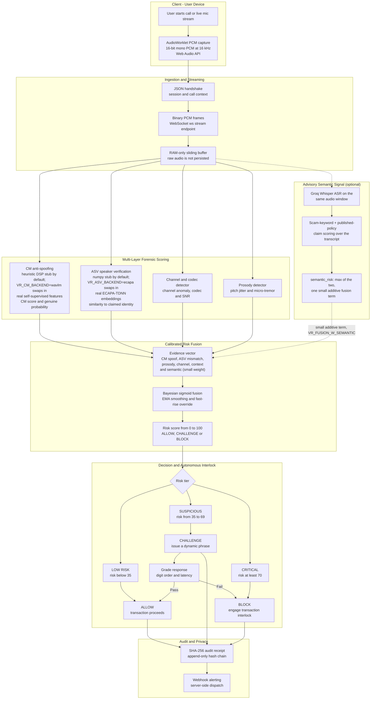
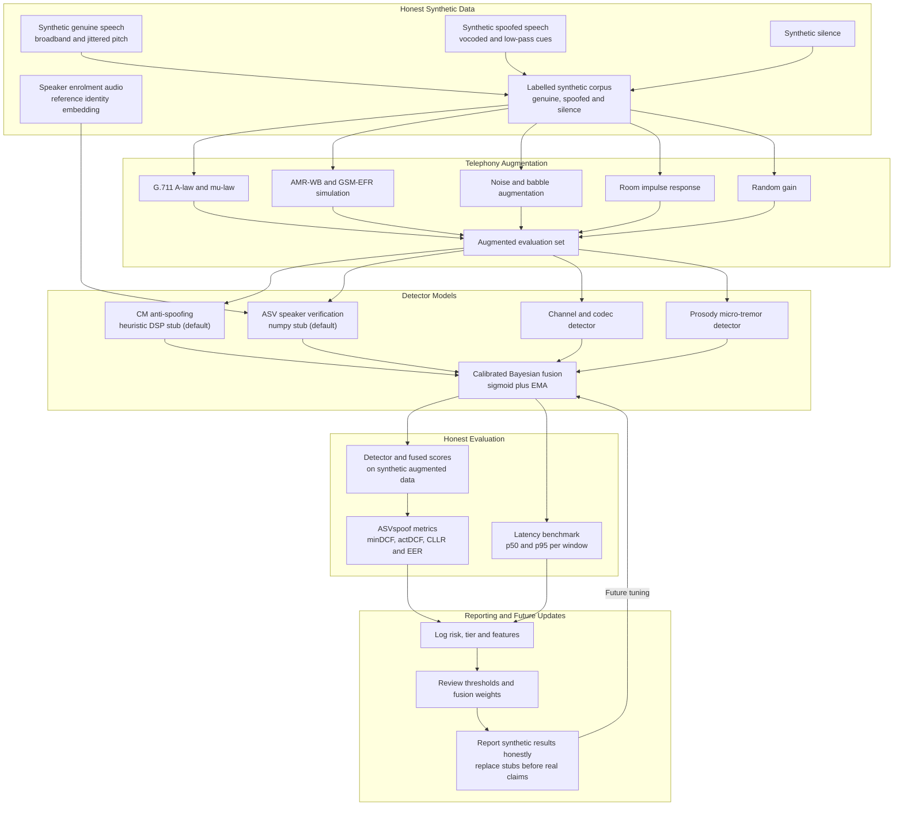
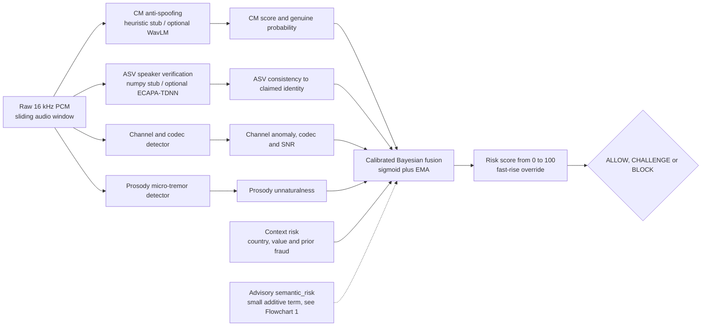

# VaniRakshak - Corrected Architecture Flowcharts

> **If your Markdown viewer fails to render the Mermaid below**, open
> `docs/flowcharts.html` in a browser - it bundles Mermaid and renders both
> diagrams directly. The syntax here was also hardened (no `&` junctions,
> ASCII-only labels) so it parses on strict renderers.

**Why these were rewritten:** the two original flowcharts described a
*semantic scam-classification system* (Speech-to-Text -> claim extraction ->
web-search fact-checking -> LLM-RAG) as the PRIMARY detector. That does
**not** match the VaniRakshak codebase. VaniRakshak (per `README.md`,
`docs/PROTOCOL.md`, `vanirakshak-backend/README.md`) is a
**Target-Conditioned Recorded-Audio Forensic System** for **real-time
detection of voice-cloning / deepfake-audio fraud on live calls**, ending in
an **autonomous transaction interlock**. Detection is **acoustic + biometric
+ Bayesian**, and the acoustic pipeline (CM/ASV/channel/prosody -> fusion)
remains the **sole authority** for `risk_score`/`tier`.

> **Update (2026-09):** an optional advisory layer now exists —
> `vanirakshak/semantic/` runs ASR (Groq Whisper) on the same audio window
> the acoustic detectors score, then a rule-based scorer over the transcript
> for known scam vocabulary and claims that contradict published bank/RBI
> policy (`docs/PROTOCOL.md` §3.1). This is **not** what the original
> flowcharts described: there is still **no web search, no LLM-RAG, and no
> semantic *classifier* deciding the verdict** — the transcript never
> reaches an LLM, and the whole signal contributes one small additive term
> (`VR_FUSION_W_SEMANTIC`, default `0.4`, versus `2.4` for the CM
> anti-spoofing term) that the acoustic pipeline can always outweigh. The
> corrections below have been updated to say so exactly where they used to
> claim no transcript or text processing exists at all — that claim is now
> false; the "acoustic pipeline is the sole *decision* authority" claim
> remains true and is the point that actually matters.

---

## Flowchart 1 - Real-Time Inference / Detection Pipeline (corrected)

---

## Flowchart 2 - Data Synthesis, Training-Prep & Evaluation Pipeline (corrected)

---

## Discrepancy Report - Original Flowchart 1 vs Repository

| Original node | Problem | Correction |
|---|---|---|
| Audio Capture (Live call, Recorded file, Screen-captured) | VaniRakshak captures live mic via AudioWorklet AND accepts recorded file uploads via POST /v1/analyze; no screen-captured path. | Live mic PCM capture at 16 kHz via Web Audio API, streamed over WebSocket |
| Speech-to-Text Service (Whisper / ASR) | STT exists but is **advisory, not primary** — Groq Whisper transcribes the same window the acoustic detectors score, contributing one small additive fusion term | Kept as an optional advisory signal (`vanirakshak/semantic/`), never the primary evidence — see `docs/PROTOCOL.md` §3.1 |
| Transcript Preprocessing / Speaker & time segmentation | A transcript is produced, but there is still no speaker diarization or time segmentation of it | Partially kept: transcript + Hinglish transliteration exist; segmentation does not |
| Claim Extraction (payments, KYC, prizes, threats, urgency) | Primary detection is still **acoustic**; a rule-based (not NLP/LLM) claim-matching layer now runs advisory-only over the transcript | Kept as `semantic/claims.py` — a curated rule set matched against published policy, not open-ended NLP; fused at weight 0.4 vs 2.4 for the acoustic CM term |
| Web Search / Scraping (RBI, NPCI, banks, news, fact-checkers) | **No web/LLM fact-checking** | Removed - replaced by calibrated Bayesian fusion over acoustic evidence |
| Fact Comparison Engine (Rules + LLM) | Not present | Removed |
| Risk Scoring (# contradictory urgent claims, scam patterns) | Risk is **Bayesian fusion** of cm/asv/prosody/channel + context | Calibrated Bayesian fusion (Layer 5) |
| Risk Tier -> Low / Medium / High / Critical | Actual tiers are **ALLOW / CHALLENGE / BLOCK**, bands LOW RISK (<35) / SUSPICIOUS (35-69) / CRITICAL (>=70) | Tiers and thresholds corrected |
| Overlay / Block payment apps / cybercrime report | Client shows verdict + interlock; alerts are webhook+email **stubs**; no external block or report API | ALLOW/CHALLENGE/BLOCK + interlock + SHA-256 audit; alerting stubbed |
| Logging / Analytics / Feedback -> Retrain | Audit + honest-eval + bench exist, but **no live user-feedback loop** | Audit (SHA-256) + DPDP; monitoring is the eval harness, not a live feedback loop |

## Discrepancy Report - Original Flowchart 2 vs Repository

| Original node | Problem | Correction |
|---|---|---|
| Real scam call recordings (anonymized) | Repo uses **honest synthetic audio only** | Removed; data is synthetic_speech vs synthetic_spoofed |
| Synthetic scam dialogues (GPT-2 / LLM) | No LLM text dialogues; audio is DSP-synthesized | Removed |
| Synthetic audio (xTTS / TTS models) | Synthetic audio is **numpy DSP** (vocoded-style) | Replaced with synthetic_speech / synthetic_spoofed generators |
| Public scam transcripts / forums | N/A | Removed |
| Audio preprocessing: Noise reduction, VAD | Sliding buffer + per-window analysis; no VAD stage in the trained-model pipeline this diagram covers | Replaced with sliding-window buffering + per-window detection |
| ASR/STT (WhisperX), Diarization, Text cleaning | Groq Whisper ASR now runs (advisory, outside this trained-model pipeline); no diarization or text cleaning | Not part of this diagram's trained models — it is a separate, untrained, rule-based advisory layer (`vanirakshak/semantic/`), fused at a small fixed weight |
| NER, Regex urgency, BERT embeddings | No BERT/NER; a curated regex/keyword scorer now exists for scam vocabulary and urgency framing | Kept as `semantic/keywords.py` — hand-written categories, not learned embeddings; advisory only |
| Speaker embeddings (Resemblyzer / ECAPA-TDNN) | ASV is a **numpy stub by default**; `VR_ASV_BACKEND=ecapa` swaps in real ECAPA-TDNN (192-dim) for speaker **verification** vs claimed_identity | Kept ECAPA as an opt-in real backend, reframed as enrolment + verification vs claimed identity |
| Prosodic features + Emotion cues | Prosody = **pitch jitter + micro-tremor consistency** (not emotion) | Prosody definition corrected |
| Call metadata, User history | Context = origin_country, transaction_value_inr, prior_fraud_score (from CRM) | Context inputs corrected |
| Text classifier (BERT / RoBERTa) | No text classifier; the advisory semantic layer is rule-based, not a trained model | Replaced with CM (heuristic DSP / optional WavLM) + ASV (numpy stub / optional ECAPA-TDNN) |
| Audio classifier (CNN / XVector) | CM is a hand-tuned heuristic — no trained anti-spoofing classifier (AASIST or otherwise) exists anywhere in this repo | Replaced; see `docs/02-technical-strategy-and-architecture.md`'s Production Upgrade Path for what training one would take |
| Hybrid Fusion (weighted average) | Real fusion is **calibrated Bayesian** (sigmoid + EMA) | Fusion corrected |
| LLM-RAG Module | None | Removed |
| Risk bands Low / Medium / High / Critical | Bands are LOW / SUSPICIOUS / CRITICAL (<35 / 35-69 / >=70) | Corrected |
| Drift detection, model updates | Monitoring is **ASVspoof-5 eval harness** (minDCF/actDCF/CLLR/EER) + honest reporting | Reframed |

---

## Gaps Both Original Flowcharts Missed

1. **The CHALLENGE interlock** - the signature feature. A dynamic phrase issued mid-call so a replay of a genuine voice cannot answer, and a live TTS is caught by latency. Absent from both charts.
2. **SHA-256 audit + DPDP Act 2023 privacy** - append-only hash-chained audit receipts; RAM-only buffer, raw audio never persisted. Absent from both.
3. **WebSocket streaming contract & server-owned decision** - ws://host:8000/ws/stream, JSON handshake then binary PCM; the server owns ALLOW/CHALLENGE/BLOCK (client thresholds exist only for demo mode). Absent from both.
4. **Augmentation stack (R1)** and the **ASVspoof-5 evaluation harness** - central to Flowchart 2, missing there.
5. **Honest-reporting standard** - all CM/ASV scores are explicitly synthetic/heuristic until real weights are opted into (`VR_CM_BACKEND=wavlm`, `VR_ASV_BACKEND=ecapa`) — and even then, CM's spoof decision stays a hand-tuned heuristic; no trained anti-spoofing classifier exists anywhere in this repo.

## Status of Repository Gaps & Implementation State

All major previously identified gaps have been addressed:
- Architecture & technical strategy: Documented in `docs/02-technical-strategy-and-architecture.md`, `docs/ARCHITECTURE.md`, `docs/API_SPEC.md`, and `docs/RUNBOOK.md`.
- Codec augmentation: Documented in `docs/03-codec-augmentation-and-telephony.md` and implemented in `vanirakshak/data/augment.py`.
- Metrics & evaluation: Documented in `docs/04-metrics-and-honest-evaluation.md` and implemented in `benchmarks/compute_mindcf.py` (`python -m vanirakshak eval`).
- Privacy & DPDP compliance: Documented in `docs/07-privacy-compliance-and-apis.md` and implemented in `vanirakshak/privacy/audit.py` and `buffer.py`.
- `Makefile` and `docker-compose.yml`: Fully written and operational.
- WebSocket reconnect logic: Implemented with 5-attempt exponential backoff and jitter in `frontend/app/page.tsx`.
- Server-side alerting: Implemented in `vanirakshak/alerts/dispatcher.py` and invoked on `CHALLENGE`/`BLOCK`.
- Real detector backends (optional): the CM/ASV nodes in both flowcharts above show the
  **default** zero-dependency stubs, which remain the default. `VR_ASV_BACKEND=ecapa` /
  `VR_CM_BACKEND=wavlm` swap in real speechbrain ECAPA-TDNN / WavLM features
  (`vanirakshak/detectors/{asv_ecapa,cm_wavlm}.py`) — real embeddings/features, but CM's
  spoof decision is still heuristic, not a trained classifier. See
  `docs/02-technical-strategy-and-architecture.md`'s Production Upgrade Path table and
  `docs/archive/AUDIT_REPORT.md` §12 for the honest, partial calibration result this produces.
- Advisory semantic signal (optional): `vanirakshak/semantic/` — Groq Whisper ASR plus a
  rule-based keyword/claim scorer, fused at a small fixed weight
  (`VR_FUSION_W_SEMANTIC`). This is genuinely new since the "no STT anywhere" claim above
  was first written; see the "Update (2026-09)" note at the top of this file and
  `docs/PROTOCOL.md` §3.1 for what it does and, just as importantly, does not do.

---

## Canonical ML-side pipeline (use THIS, not the "fixed" variant)

> **Heads-up:** a diagram titled **"VaniRakshak - ML Pipeline (Fixed Mermaid
> Syntax)"** has been circulating. It is **syntactically valid** (it renders) but
> it describes a **different product** - a *semantic scam-call classifier*
> where transcription and text classification are the primary decision path
> (Whisper STT -> NER/BERT -> CNN/XVector -> LLM-RAG -> weighted scam-score 0-1).
> VaniRakshak's real ML side does now run ASR (see the Semantic subgraph in
> Flowchart 1 above), but **never as the decision path** — there is no
> BERT/CNN/XVector classifier, no LLM-RAG, and no "scam probability" score;
> the transcript only ever contributes one small additive term to a
> fusion that acoustic evidence dominates. Do **not** paste that diagram into
> the README as this system's design. The correct ML-side architecture is
> Flowchart 1 above; the condensed acoustic-side view is below (the semantic
> layer is omitted here for clarity — see Flowchart 1's Semantic subgraph).

### Why the "fixed" ML diagram is wrong (ML side only)

| "Fixed" diagram claims | What the repo actually has |
|---|---|
| S1 Whisper/WhisperX STT -> transcript + speaker tags feeding the primary decision | ASR now runs (Groq Whisper, `vanirakshak/semantic/`), but only as a small advisory term — not a step in the primary decision path, and no speaker-tagging/diarization |
| S2 text NER / regex / BERT embeddings | A curated regex/keyword scorer exists (`semantic/keywords.py`), not NER or learned BERT embeddings |
| S2 audio: Resemblyzer/ECAPA embeddings, prosody (pitch/energy/rate), emotion | ASV (numpy stub / optional ECAPA) is a **verification** signal vs `claimed_identity`, not a bare embedding; prosody = **pitch-jitter + micro-tremor** (a spoof cue), **no emotion**; missing the CM anti-spoofing and channel/codec branches entirely |
| S3 BERT text classifier, CNN/XVector audio classifier, LLM-RAG -> P_text/P_audio/P_pattern | No classifiers, no LLM; outputs are `cm_score`, `asv_consistency`, `channel_anomaly`, `prosody_unnatural`, `snr_db` |
| S4 weighted avg of scam probs (0-1) | Calibrated **Bayesian** fusion of **spoof** evidence, EMA + fast-rise override, output **risk 0-100** |
| S5/S6 bands 0.3/0.6/0.85 + "block payment apps"; retrain from feedback | Tiers **ALLOW/CHALLENGE/BLOCK** at <35/35-69/>=70; **CHALLENGE** (dynamic phrase) is the signature; logging is SHA-256 audit + ASVspoof-5 eval, **no live feedback loop / auto-retrain** |
